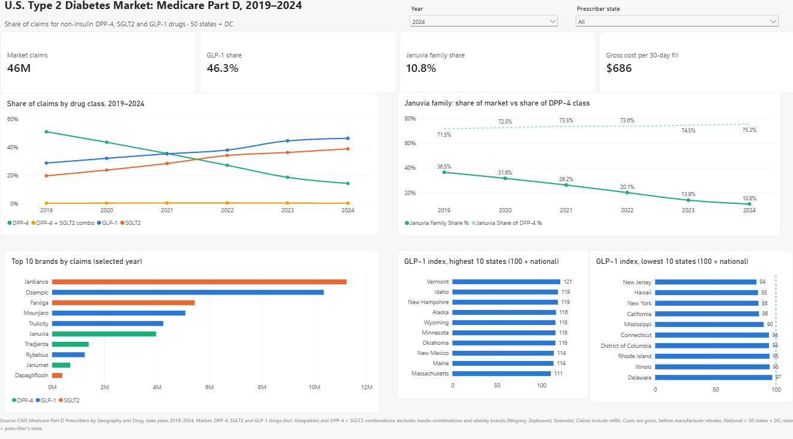
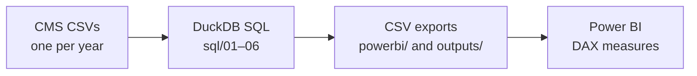

# U.S. Type 2 Diabetes Market Dashboard (Medicare Part D, 2019–2024)

How GLP-1s and SGLT2s overtook DPP-4s in Medicare Part D, and what that meant for MSD's Januvia family: a SQL (DuckDB) pipeline feeding a Power BI dashboard.

## Dashboard



PDF version: [powerbi/dashboard.pdf](powerbi/dashboard.pdf) · Power BI file: [powerbi/diabetes_market_dashboard.pbix](powerbi/diabetes_market_dashboard.pbix)

## Business questions

1. How did each drug class's share of claims change from 2019 to 2024?
2. How did MSD's Januvia family (Januvia, Janumet, Janumet XR) perform: share of the whole market and share within the DPP-4 class, by year?
3. In 2024, which states over- or under-index on GLP-1 share versus the national level?
4. What is the gross cost per standardized 30-day fill by class and year?
5. Which brands lead the market each year, and where does Januvia rank?

## Key findings

- **GLP-1s became the largest class.** Their share of claims rose from 28.8% in 2019 to 46.3% in 2024, passing DPP-4s in 2022 (38.0% vs 27.2%). Over the same years SGLT2s rose from 19.8% to 38.9% and DPP-4s fell from 51.0% to 14.4%. ([q1](outputs/q1_class_share_by_year.csv))
- **The market grew, but the Januvia family did not grow with it.** Market claims went from 16,600,059 in 2019 to 46,359,070 in 2024 ([reconciliation](outputs/validation_reconciliation.csv), `state_sum_claims`), while Januvia-family claims went from 6,053,593 to 5,017,634 and its share of the market fell from 36.5% to 10.8%. ([q2](outputs/q2_januvia_family.csv))
- **Within the DPP-4 class, the Januvia family gained share:** from 71.5% in 2019 to 75.3% in 2024. ([q2](outputs/q2_januvia_family.csv))
- **Januvia fell from #1 to #6.** By claims it ranked #1 in 2019–2021, #3 in 2022, #5 in 2023 and #6 in 2024 (8.6% share). Jardiance has ranked #1 since 2022; in 2024 it held 24.2%, ahead of Ozempic (22.4%), Farxiga (11.7%), Mounjaro (11.0%) and Trulicity (9.2%). ([q5](outputs/q5_top_brands_by_year.csv))
- **GLP-1 share varies widely by state, and GLP-1s cost the most per fill.** Against a 2024 national GLP-1 share of 46.3%, the GLP-1 index ranges from 121.2 in Vermont (56.2% share) to 83.9 in New Jersey (38.9%) ([q3](outputs/q3_state_glp1_index_2024.csv)). In 2024 the gross cost per 30-day fill was $935.84 for GLP-1s versus $492.78 for DPP-4s and $537.38 for SGLT2s. Across all classes it rose from $523.47 in 2019 to $719.69 in 2023, then fell to $685.56 in 2024. ([q4](outputs/q4_cost_per_fill_by_class.csv))

## Implications for a brand team

- **The Januvia family's decline suggests the main driver is its class shrinking, not losing ground to other DPP-4 brands.** Its share within DPP-4 rose from 71.5% to 75.3%, while the DPP-4 class kept losing market share (−4.3 percentage points in 2024 alone). This suggests volume forecasts should follow the DPP-4 class trend more than competitor share. *(Findings 1 and 3.)*
- **New Jersey, New York and California under-index on GLP-1 share** (GLP-1 index 83.9, 85.6 and 86.0), which is worth investigating. This data can't say whether the cause is access, prescriber habits or patient mix. *(Finding 5.)*
- **2024 suggests a natural baseline for measuring what comes next:** 5,017,634 Januvia-family claims and a DPP-4 gross cost of $492.78 per 30-day fill, recorded before loss of exclusivity and Medicare negotiated prices take effect (see [Context](#context)). *(Findings 2 and 5.)*

## Data source

CMS, [Medicare Part D Prescribers - by Geography and Drug](https://data.cms.gov/provider-summary-by-type-of-service/medicare-part-d-prescribers/medicare-part-d-prescribers-by-geography-and-drug), data years 2019–2024 (one CSV per year). The download script finds the CSV links in the CMS data catalog, <https://data.cms.gov/data.json>.

Each row is one geography (National or a state) × one drug (brand + generic name), with total claims, standardized 30-day fills and gross drug cost.

## Market definition and exclusions

**Drug classes.** Products are assigned by the molecules in their generic name:

| Class | Molecules |
|---|---|
| DPP-4 | sitagliptin, saxagliptin, linagliptin, alogliptin |
| SGLT2 | canagliflozin, dapagliflozin, empagliflozin, ertugliflozin, bexagliflozin |
| GLP-1 (incl. dual GIP/GLP-1) | semaglutide, dulaglutide, liraglutide, exenatide, lixisenatide, tirzepatide, albiglutide |
| DPP-4 + SGLT2 combo | any product containing both a DPP-4 and an SGLT2 molecule |

- Rules are applied in order: combo first, then DPP-4, SGLT2, GLP-1. Metformin and pioglitazone combinations keep the class of their other molecule, e.g. Janumet is DPP-4.
- Molecules are matched by stem (e.g. `dapaglifloz`), because CMS truncates some generic names, e.g. "Dapaglifloz Propaned/Metformin".
- One product = one brand name. Pack and device variants are grouped into brand families for the brand ranking: Victoza 2-Pak and 3-Pak → Victoza; Bydureon, Bydureon BCise and Bydureon Pen → Bydureon. Unbranded generics (e.g. Dapagliflozin, Sitagliptin) are ranked under their molecule name.
- **Januvia family** = Januvia, Janumet, Janumet XR. **MSD brands** = the Januvia family plus Steglatro, Segluromet and Steglujan.

**Excluded** ([excluded_products.csv](outputs/excluded_products.csv)):

| Brand | Generic | Reason |
|---|---|---|
| Saxenda | Liraglutide | Obesity brand |
| Wegovy | Semaglutide | Obesity brand |
| Zepbound | Tirzepatide | Obesity brand |
| Soliqua 100-33 | Insulin Glargine/Lixisenatide | Insulin combination |
| Xultophy 100-3.6 | Insulin Degludec/Liraglutide | Insulin combination |

**Geography.** The analysis uses the 50 states + DC. "National" means the sum of those states. Territories, armed forces, unknown and foreign locations are left out (they are itemised in the reconciliation below).

## Approach



1. [scripts/download_data.py](scripts/download_data.py) finds the yearly CSVs in the CMS catalog and downloads them to `data/raw/`.
2. [scripts/run_pipeline.py](scripts/run_pipeline.py) runs the six SQL files in order in a DuckDB database (`data/partd.duckdb`), stopping at the first error.
3. The SQL exports a star schema for Power BI (`fact_state_product_year` + `dim_product`) and one CSV per business question and validation result to `outputs/`.
4. Power BI loads the two model CSVs and calculates the dashboard with the [DAX measures](#dax-measures) below.

## SQL highlights

| File | What it does | Techniques |
|---|---|---|
| [01_load_raw.sql](sql/01_load_raw.sql) | Loads all yearly CSVs into one table as text | `read_csv` with a wildcard, `union_by_name` |
| [02_dim_product.sql](sql/02_dim_product.sql) | Builds the product dimension and exclusion list | CASE-based class mapping (in a reusable macro), CTEs, `arg_max` for latest spelling, `ROW_NUMBER()` |
| [03_fact.sql](sql/03_fact.sql) | Builds the state × product × year fact table | JOIN + GROUP BY, `TRY_CAST`, shared views that define the source rows once |
| [04_analysis.sql](sql/04_analysis.sql) | One view per business question | CTEs, window functions `SUM() OVER`, `LAG`, `RANK`, `UNION ALL`, `NULLIF` |
| [05_validation.sql](sql/05_validation.sql) | Reconciliation and data-quality checks | conditional sums `SUM(CASE …)`, `EXISTS`, `UNION ALL` |
| [06_export.sql](sql/06_export.sql) | Writes the CSVs | `COPY … TO` |

Example: class share and year-on-year change (Q1), using one CTE for the share and the next for the change:

```sql
with_share AS (
    SELECT data_year, drug_class, claims,
           100.0 * claims / sum(claims) OVER (PARTITION BY data_year) AS share_pct
    FROM class_year
),
with_change AS (
    SELECT data_year, drug_class, claims, share_pct,
           share_pct - LAG(share_pct) OVER (PARTITION BY drug_class ORDER BY data_year)
               AS change_vs_prior_year_pp
    FROM with_share
)
```

## DAX measures

```dax
Total Claims = SUM ( fact_state_product_year[total_claims] )
Total 30-Day Fills = SUM ( fact_state_product_year[total_30day_fills] )
Total Gross Cost = SUM ( fact_state_product_year[total_drug_cost] )
Market Claims = CALCULATE ( [Total Claims], REMOVEFILTERS ( dim_product ) )
Market Share % = DIVIDE ( [Total Claims], [Market Claims] )
GLP-1 Share % = CALCULATE ( [Market Share %], dim_product[drug_class] = "GLP-1" )
GLP-1 Index = DIVIDE ( [GLP-1 Share %], CALCULATE ( [GLP-1 Share %], REMOVEFILTERS ( fact_state_product_year[state_name] ) ) ) * 100
Januvia Family Share % = CALCULATE ( [Market Share %], dim_product[januvia_family] = 1 )
Januvia Share of DPP-4 % = DIVIDE ( CALCULATE ( [Total Claims], dim_product[januvia_family] = 1 ), CALCULATE ( [Total Claims], REMOVEFILTERS ( dim_product ), dim_product[drug_class] = "DPP-4" ) )
Gross Cost per 30-Day Fill = DIVIDE ( [Total Gross Cost], [Total 30-Day Fills] )
```

`Market Claims` removes product filters but keeps the year and state filters, so every share is "out of the whole market in the selected year and state". `GLP-1 Index` compares the selected state's GLP-1 share with the share across all states.

## Validation

**Reconciliation** ([validation_reconciliation.csv](outputs/validation_reconciliation.csv)): CMS's own National claim total versus the 51-state sum, for the same in-market products. The gap is broken down by the geographies the analysis leaves out. The small residual is consistent with the State rows CMS leaves out for having fewer than 11 claims, which still count in the National total.

| Year | CMS National | 51-state sum | Difference | % diff | Puerto Rico | Other territories | Armed forces | Unknown | Foreign | Residual |
|---|---|---|---|---|---|---|---|---|---|---|
| 2019 | 16,896,074 | 16,600,059 | 296,015 | 1.75 | 289,457 | 3,779 | 1,313 | 138 | 276 | 1,052 |
| 2020 | 19,096,359 | 18,739,913 | 356,446 | 1.87 | 348,430 | 4,692 | 1,738 | 263 | 381 | 942 |
| 2021 | 22,147,432 | 21,733,763 | 413,669 | 1.87 | 403,553 | 6,374 | 2,044 | 385 | 422 | 891 |
| 2022 | 27,107,184 | 26,595,184 | 512,000 | 1.89 | 500,742 | 7,277 | 1,925 | 513 | 593 | 950 |
| 2023 | 36,872,510 | 36,210,498 | 662,012 | 1.8 | 648,783 | 8,506 | 2,379 | 658 | 752 | 934 |
| 2024 | 47,205,901 | 46,359,070 | 846,831 | 1.79 | 832,234 | 9,119 | 2,458 | 956 | 1,072 | 992 |

**Checks** ([validation_checks.csv](outputs/validation_checks.csv)), all passing:

| Check | Expected | Actual |
|---|---|---|
| 1. 51 states in every year | 51 in each of 6 years | min 51, max 51, across 6 years |
| 2. No duplicate raw rows per data_year × geography × brand_key (before aggregation) | 0 | 0 |
| 3a–3c. Cast failures in claims, fills and cost | 0 | 0 |
| 4. Blank claim values | 0 | 0 |
| 5. Brand spot checks: Januvia, Janumet, Janumet XR, Tradjenta → DPP-4; Jardiance, Farxiga → SGLT2; Ozempic, Trulicity, Mounjaro, Rybelsus → GLP-1; Glyxambi, Steglujan → DPP-4 + SGLT2 combo; Wegovy, Zepbound, Saxenda, Soliqua, Xultophy → excluded | as listed | all match |
| 6. Every drug class has claims in every year | 24 (4 classes x 6 years) | 24 |
| 7. Smallest in-market State claim value is at least 11 | >= 11 | 11 |
| 8. Each data year comes from exactly one file | 1 file for each of 6 years | min 1, max 1 files per year |
| 9. Each brand gets the same drug class from every year's generic spelling | 0 | 0 |

## Limitations

- **Medicare Part D only.** Commercial insurance, Medicaid and cash prescriptions are not included.
- **Claims are not patients.** A claim is a prescription fill, including refills; one patient can have many.
- **State = the prescriber's practice state**, not where the patient lives.
- **No diagnosis field.** Use for Type 2 diabetes can't be separated from other uses, e.g. SGLT2s are also prescribed for heart failure and kidney disease.
- **Gross cost before manufacturer rebates**, so it overstates what payers actually pay.
- **CMS leaves out State rows with fewer than 11 claims** (this data has no blanks), so state totals are slightly below CMS's National total.
- **Data lags about two years**: the latest year available is 2024.

## Context

Per Merck's Q1 2026 Form 10-Q, Januvia and Janumet were set to lose U.S. market exclusivity in May 2026 and Janumet XR in July 2026. Medicare negotiated prices apply to Januvia, Jardiance and Farxiga from 1 Jan 2026 and to Janumet/Janumet XR, Tradjenta and Ozempic/Rybelsus from 1 Jan 2027. So 2019–2024 is the baseline before both.

## How to reproduce

From the project root, on Windows or any OS with Python 3:

```
python -m pip install -r requirements.txt
python scripts/download_data.py
python scripts/run_pipeline.py
```

- The download script skips years already in `data/raw/`. If data.cms.gov blocks your network, download the six CSVs another way and save them as `data/raw/geo_drug_<year>.csv`.
- The pipeline rebuilds everything from scratch and prints each table's row count; check [outputs/validation_checks.csv](outputs/validation_checks.csv) afterwards.
- Open [powerbi/diabetes_market_dashboard.pbix](powerbi/diabetes_market_dashboard.pbix) in Power BI Desktop and refresh. If prompted, point it at `powerbi/fact_state_product_year.csv` and `powerbi/dim_product.csv` (Transform data → Data source settings).

## Folder structure

```
diabetes-market-dashboard/
├── data/raw/            CMS CSVs, one per year (not in git)
├── sql/                 01_load_raw … 06_export: the whole pipeline
├── scripts/             download_data.py, run_pipeline.py
├── outputs/             answers to Q1–Q5, validation results, excluded products
├── powerbi/             model CSVs, .pbix file, dashboard.pdf
├── images/              dashboard.png
├── requirements.txt
└── README.md
```
